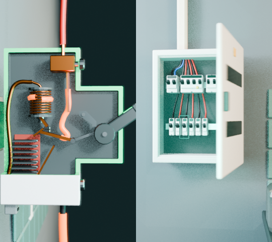

# Diorama

**Declarative, deterministic explainer shots for Blender. Safe for agents,
cacheable, offline.**

Diorama turns a small JSON file into a short 3D shot rendered by Blender: a
circuit breaker cut open while current flows and the bimetal trips, an electrical
panel whose door swings open, an appliance shown in section. It is built for
explainer videos and for tools, including LLM agents, that need to describe a
shot instead of writing Blender code.



## Why Diorama

- **Data, never code.** A shot is a JSON document validated against a public
  schema. Nothing in it is executed, so it is safe to accept from a user or a
  language model. Component code lives in the package and is reviewed.
- **Deterministic.** Animation is derived only from the frame number. The same
  shot, package version and Blender version produce the same pixels, so renders
  can be cached by signature and split across processes.
- **An explainer vocabulary.** Components expose anchors and events that tell a
  story: `section`, `explode`, `assemble`, `flow`, `trip`, `switch-on`,
  `highlight`.
- **Offline and isolated.** Runs with `--factory-startup --offline-mode`; library
  assets are referenced by SHA-256.

## Quick start

1. Install [Blender 5.2 LTS](https://www.blender.org/download/lts/).
2. Clone this repository.
3. Render a few frames of an example:

```sh
blender -b --factory-startup --offline-mode -noaudio --python-exit-code 1 \
  --python run.py -- \
  --spec examples/circuit-breaker-inside.json --out frames \
  --start 0 --end 30 --scale 50 --samples 16
```

Frames are written as `frames/f_00001.png`, `frames/f_00002.png`, ... Encode them
with any tool, for example
`ffmpeg -framerate 30 -i frames/f_%05d.png -pix_fmt yuv420p shot.mp4`.

## A shot

```json
{
  "schema": "diorama.shot/1",
  "id": "breaker-trips",
  "durationFrames": 90,
  "set": { "component": "kitchen-corner@1", "params": { "counter": false } },
  "entities": [
    { "id": "breaker", "component": "circuit-breaker@1", "position": [0, -0.185, 1.45] }
  ],
  "events": [
    { "action": "flow", "target": "breaker", "frame": 0, "endFrame": 60, "load": "overload" },
    { "action": "trip", "target": "breaker", "frame": 60, "cause": "overload" }
  ],
  "camera": {
    "keys": [{ "frame": 0, "position": [0.25, -0.75, 1.5], "target": [0, -0.185, 1.45], "lens": 50 }]
  }
}
```

Every field not given takes its default. The complete format is
[spec/shot.schema.json](spec/shot.schema.json); the rules JSON Schema cannot
express (event targets, anchors, frame ranges) are in [spec/README.md](spec/README.md).

## What is in the box

| Component            | Kind   | Anchors                                                        | Events                                                       |
| -------------------- | ------ | -------------------------------------------------------------- | ------------------------------------------------------------ |
| `kitchen-corner@1`   | set    | —                                                              | —                                                            |
| `electrical-panel@1` | entity | `center`, `door-handle`, `main-lever`, `inside`, `lower-row`   | `open-door`, `highlight`, `flow`, `trip`, `switch-on`        |
| `circuit-breaker@1`  | entity | `center`, `lever`, `contacts`, `bimetal`, `coil`, `arc-chute`  | `flow`, `trip`, `switch-on`, `section`, `explode`, `assemble` |
| `appliance@1`        | entity | `center`, `indicator`                                          | `power`, `section`                                           |
| `asset@1`            | entity | `center`, `top`                                                | —                                                            |

`asset@1`, HDRI environments and PBR surfaces use files from your own asset
library, passed with `--assets` (see [spec/README.md](spec/README.md#assets)).

## Use it from your app

Diorama runs as a separate Blender process and talks through files, arguments
and one line per event on stdout:

```text
DIORAMA_BUILD seconds=0.22 interpreter=0.1.1
DIORAMA_FRAME 42
DIORAMA_DONE
DIORAMA_ERROR dioramaUnknownAnchor camera/keys/0/focus
```

Exit code `0` means success and `3` a known failure with a stable code.
Each [release](https://github.com/oGabrielSilva/diorama3d/releases) has a
`diorama3d-<version>.tar.gz` with `run.py`, the package and the licenses; pin
its SHA-256 (in the release notes) and run `run.py` from the unpacked folder. Validate
shots before launching Blender with the JSON Schema in any language, or with the
pure-Python core:

```python
from diorama3d.core import SpecError, load_shot

shot = load_shot(spec)  # normalized copy with defaults, or SpecError(code, issues)
```

QVid Studio, a desktop app for vertical explainer videos, is the first app built on Diorama.

## Status

Pre-1.0: the format is `diorama.shot/1`, but fields may still change before
1.0. Supported Blender: 5.2 LTS. See [CHANGELOG.md](CHANGELOG.md) and the
[roadmap](docs/roadmap.md).

## Contributing

Contributions are welcome. Read [CONTRIBUTING.md](CONTRIBUTING.md) (setup,
determinism rules, how to add a component) and the
[Code of Conduct](CODE_OF_CONDUCT.md). Security reports: [SECURITY.md](SECURITY.md).

## License

Two licenses, by folder ([LICENSE.md](LICENSE.md)):

- the code that runs inside Blender (`diorama3d/`, `run.py`) is
  **GPL-3.0-or-later**, as Blender requires for code that uses its Python API;
- the format, examples and documentation (`spec/`, `examples/`, `docs/`) are
  **Apache-2.0**, so any application, open or proprietary, can read and write
  Diorama shots.

Blender is a trademark of the Blender Foundation. Diorama is an independent
project, not affiliated with or endorsed by the Blender Foundation.
